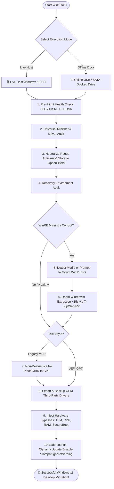

<p align="center">
  <a href="https://github.com/remarkablepc/Win10to11/releases/latest">
    
  </a>
  <a href="https://github.com/remarkablepc/Win10to11/releases">
    
  </a>
  
  
  
  <a href="https://www.paypal.com/ncp/payment/EKH76RTYHH24S?uhm=Win10to11">
    
  </a>
  <a href="https://github.com/sponsors/remarkablepc?uhm=Win10to11">
    
  </a>
</p>

# Win10to11
### *The Autonomous Windows 10 to 11 In-Place Upgrade, Repair & Bypass Toolkit*
**Engineered by [RemarkablePC](https://github.com/remarkablepc) to diagnose, repair, convert, and orchestrate zero-fail Windows 11 upgrades on both live host machines and offline USB-docked drives.**

<p align="center">
  <a href="https://github.com/remarkablepc/Win10to11/archive/refs/heads/main.zip">
    
  </a>
  &nbsp;&nbsp;&nbsp;
  <a href="https://github.com/remarkablepc/Win10to11/releases/latest">
    
  </a>
  &nbsp;&nbsp;&nbsp;
  <a href="https://github.com/sponsors/remarkablepc?uhm=Win10to11">
    
  </a>
  &nbsp;&nbsp;&nbsp;
  <a href="https://www.paypal.com/ncp/payment/EKH76RTYHH24S?uhm=Win10to11">
    
  </a>
</p>

---

## 💡 Why Win10to11 Exists: The Technician's Story

If you have ever spent hours on a customer PC or your own workstation fighting a Windows 10 to 11 upgrade that stubbornly refuses to complete, you know this exact loop:

```text
┌──────────────────────────────────────────────┐
│  1. Launch Windows Setup                     │
│  2. Wait 45 minutes (creeps to 73%)          │
│  3. Crash & Rollback: 0x80070714 / 0x801F0005│
│  4. Dig through 150MB of setupact.log        │
│  5. 4+ hours wasted... back to square one!   │
└───────────────────────┬──────────────────────┘
                        ▼
            [Enter Win10to11 Toolkit]
```

You are greeted by an opaque hex code like **`0x80070714`**, **`0x801F0005`**, or **`0xC1900101 - 0x40021`**. Then starts the manual archaeology:
- Hunting through hundreds of thousands of lines in `C:\$WINDOWS.~BT\Sources\Panther\setupact.log`.
- Discovering that an uninstalled third-party antivirus (Avast, AVG, Norton, McAfee) secretly left behind an active kernel minifilter (`aswSnx.sys`, `SRTSPX64.SYS`) or a disk `UpperFilter` (`aswArDisk`) that intercepted the SafeOS WIM mount and returned `ERROR_FLT_INVALID_NAME_REQUEST`.
- Finding that the Windows Recovery Environment (`Winre.wim`) is missing or has a desynchronized partition GUID in `ReAgent.xml`.
- Struggling to convert an MBR disk to GPT on a drive pulled from a non-booting PC into an external bench dock where Microsoft's native `mbr2gpt` refuses to operate.
- Dealing with arbitrary CPU, TPM 2.0, RAM, or SecureBoot blocks on otherwise fast, capable hardware.

**I built Win10to11 because I was tired of Windows 10 failing to upgrade to Windows 11 over and over again, wasting countless hours of manual troubleshooting on the bench.**

Win10to11 encapsulates years of battle-tested field diagnosis into a single, automated, and deterministic PowerShell engine. It detects and neutralizes these blockers *before* Windows Setup ever runs, giving you a smooth, predictable upgrade on the first pass.

---

## 🔄 Autonomous Upgrade Architecture



---

## ⚡ The Upgrade Killers Win10to11 Cures

| Error Code / Symptom | Root Cause | How Win10to11 Solves It |
| :--- | :--- | :--- |
| **`0x801F0005` / `0x80070714`**<br>*(SafeOS Pre-Finalize Driver Migration Crash)* | Antivirus minifilters (`aswMonFlt`, `aswSnx`, `SRTSPX64`) or legacy disk `UpperFilters` (`aswArDisk`, `Snapman`, `fltsrv`) intercepting mounted SafeOS WIM reparse points. | **Universal Minifilter Discovery**: Enumerates all services with an `Instances` key, cross-checks against a Microsoft core whitelist, unhooks rogue filters, and resets device class `UpperFilters` to defaults using direct registry writes. |
| **`0x80070714`**<br>*(WinRE SafeOS Staging Failure)* | Missing `Winre.wim`, corrupted recovery partition, or stale partition GUIDs in `ReAgent.xml`. | **Recovery Audit & Rapid Extraction**: Checks `ReAgent.xml` health. If corrupted or missing, auto-detects mounted setup media or prompts the technician to mount a Windows 11 ISO/USB. Unpacks a pristine `Winre.wim` directly from `sources\install.esd` / `install.wim` via 7-Zip/NanaZip in ~15 seconds and re-indexes recovery pointers. |
| **`0xC1900101 - 0x40021`**<br>*(Second-Boot Sysprep Rollback)* | Generic drivers fetched via Dynamic Update colliding with OEM hardware, corrupted user profile `.bak` keys, or corrupt performance counters. | **Pre-Emptive Cleanup**: Audits and backs up all OEM drivers via `Export-WindowsDriver`, cleans duplicate profile registry keys, rebuilds counters (`lodctr /R`), and executes setup with `/DynamicUpdate Disable`. |
| **Hardware Gatekeeping**<br>*(CPU, TPM 2.0, SecureBoot, RAM)* | Windows 11 setup requirements blocking perfectly serviceable machines. | **Zero-Touch Bypasses**: Injects `AllowUpgradesWithUnsupportedTPMOrCPU` and complete `LabConfig` suite; dynamically stages a 0-byte `appraiserres.dll` hardware check neutralizer (clean-room compliant). |
| **Legacy BIOS / MBR Partition Style** | Windows 11 strictly mandates UEFI firmware and GPT partition structure. | **Non-Destructive In-Place Conversion**: Runs native `mbr2gpt` on live host machines. For offline docked drives (where `mbr2gpt` cannot run), prompts on-demand to fetch open-source `gptgen`, runs a read-only dry-run simulation, auto-shrinks partition space if needed, saves a binary `.bin` MBR backup, writes GPT, and guides FAT32 EFI partition (ESP) & BCD creation. |
| **Storage Accelerator Conflicts** | Samsung RAPID Mode RAM caching or incompatible Intel RST drivers. | **Heuristic Detection**: Warns against volatile RAM write-caching and checks Intel RST driver revisions against Microsoft block thresholds (`< 15.9.8.1050` or `17.0.x - 17.5.x`). |

---

## 🚀 Key Features

* **Dual-Mode Flexibility (Live Host or Bench Dock)**:
  * Run directly on the live Windows 10 workstation you are upgrading.
  * Or dock a customer's drive into an external USB/SATA dock (`-TargetDriveLetter P:`), load offline hives, repair components, and generate a 1-click self-contained launcher on the customer's desktop.
* **Universal Minifilter & Driver Sanitizer**:
  * Scans across 12+ security vendors: **Avast/AVG, Symantec/Norton, McAfee, Kaspersky, Bitdefender, Trend Micro, Sophos, Malwarebytes, Webroot, ESET, and Acronis True Image**.
  * Generic Minifilter Heuristic unhooks any unknown kernel filter driver with an `Instances` key not on Microsoft's whitelist.
  * Sanitizes DiskDrive (`partmgr`), Volume (`volsnap`), and Keyboard (`kbdclass`) `UpperFilters`.
* **Automated OEM Driver Backup**:
  * Backs up all installed third-party drivers to `$ScriptDir\drivers_backup_<PC>_<Timestamp>` using `Export-WindowsDriver` prior to upgrade initiation.
* **Rapid WinRE Recovery Repair (~15 Seconds with Mounted ISO)**:
  * Audits `ReAgent.xml` and validates `Winre.wim` integrity on both live and offline installations.
  * If WinRE is missing or corrupted, prompts the technician to mount a Windows 11 ISO or plug in a setup USB (or auto-detects already mounted media or local ISO).
  * Rapidly unpacks `Winre.wim` directly from `sources\install.esd` or `install.wim` using 7-Zip or NanaZip in ~15 seconds—avoiding multi-gigabyte DISM extraction passes—and automatically re-binds recovery pointers with `reagentc`.
* **Non-Destructive In-Place MBR-to-GPT Conversion**:
  * *Live Host:* Runs validated `mbr2gpt.exe /convert /disk:N /allowFullOS`, falling back to `gptgen` if Microsoft layout checks fail.
  * *Offline Dock:* Prompts to download open-source `gptgen` on-demand from GitHub if not already present in the folder. Performs a mandatory read-only dry-run layout test, auto-shrinks the last partition by 16MB if end-of-disk space is required for the backup GPT table, backs up the original MBR to a `.bin` file, and guides the technician through EFI System Partition (ESP) verification/creation and fresh UEFI bootloader staging (`bcdboot`).
* **Health Check Caching**:
  * Includes `-SkipHealthChecks` switch and automatic 24-hour verification markers to eliminate redundant 30-minute SFC/DISM re-scans when bench testing.

---

## 📦 Quick Start Guide

### Option 1: Double-Click Launcher (GUI / Interactive)
1. Download the latest source package: [**Download ZIP**](https://github.com/remarkablepc/Win10to11/archive/refs/heads/main.zip).
2. Extract the archive to a folder (e.g. `C:\Win10to11`).
3. Right-click **`run.bat`** and select **Run as Administrator**.
4. Follow the interactive numbered menu prompts.

### Option 2: PowerShell Command Line (Technician / Headless)
Open an elevated Administrator PowerShell prompt:

```powershell
# Interactive run on current live machine
.\Win10to11.ps1

# Full zero-touch automated run (apply bypasses, backup drivers, auto-launch setup)
.\Win10to11.ps1 -AutoLaunch -BypassAll

# Fast run (skipping SFC/DISM if drive health has already been verified)
.\Win10to11.ps1 -AutoLaunch -BypassAll -SkipHealthChecks

# Bench technician mode: Service an offline customer drive docked as P:
.\Win10to11.ps1 -TargetDriveLetter P: -BypassAll
```

### CLI Parameter Reference

| Parameter | Type | Default | Description |
| :--- | :--- | :--- | :--- |
| `-TargetDriveLetter` | String | Current System (`C:`) | Target Windows partition drive letter (e.g. `O:`, `P:`). Also accepts disk numbers (e.g. `0`). |
| `-SkipElevation` | Switch | `$false` | Skips self-elevation prompt (essential for automated RMM / deployment scripts). |
| `-AutoLaunch` | Switch | `$false` | Automatically launches Windows 11 Setup once all readiness checks pass. |
| `-BypassAll` | Switch | `$false` | Headless mode: auto-approves hardware bypasses, driver backups, and defaults without pauses. |
| `-SkipHealthChecks` | Switch | `$false` | Skips CHKDSK, SFC, and DISM scans (saves 20-30 minutes if drive health was already verified). |

---

## 🛠️ Repository Structure

```text
Win10to11/
├── Win10to11.ps1             # Core autonomous PowerShell upgrade engine
├── run.bat                   # High-privilege batch launcher with argument forwarding
├── LICENSE                   # Open source MIT License
├── README.md                 # Project documentation & technical specifications
└── .gitignore                # Excludes runtime logs, driver backups, and on-demand tools
```

---

## 🔒 Clean Room & On-Demand Architecture

* **Zero Copyright Infringement**: Contains zero proprietary Microsoft binaries or redistributables. The `appraiserres.dll` hardware bypass is generated dynamically in-memory as an empty 0-byte file (the standard Rufus clean-room method).
* **On-Demand Third-Party Tooling**: Third-party binaries like `gptgen` are **never bundled in the git repository**. When an offline docked disk conversion requires `gptgen`, the script queries GitHub's official release API and downloads the verified open-source release on-demand with technician consent (or uses an existing local copy if already present).

---

## 💼 More Tools by RemarkablePC

* **[WINBARS](https://github.com/remarkablepc)** — Desktop taskbar enhancement and multi-monitor productivity workspace for Windows.
* **[Page2Divi](https://github.com/remarkablepc)** — Web layout and content conversion automation for WordPress and Divi environments.

---

## ❤️ Community Support & Sponsorship

Win10to11 is **100% free and open source**.

If this script saved you from hours of hair-pulling troubleshooting, rescued an unbootable machine from rollback loops, or sped up your bench repair turnaround time, please consider buying a coffee or sponsoring development:

* **[☕ Say Thanks via PayPal](https://www.paypal.com/ncp/payment/EKH76RTYHH24S?uhm=Win10to11)**
* **[💖 Sponsor on GitHub Sponsors](https://github.com/sponsors/remarkablepc?uhm=Win10to11)**

---

## ⚖️ License

Distributed under the **MIT License**. See [`LICENSE`](LICENSE) for more information.  
Third-party utilities downloaded on-demand (such as `gptgen`) remain under their respective open-source licenses (ISC License).
